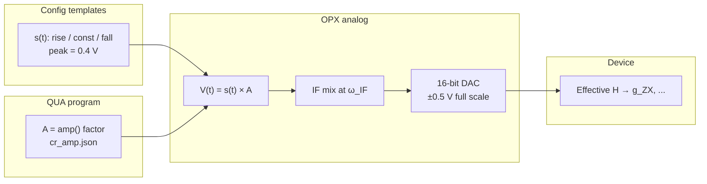

# OPX amplitude scales and CR calibration (hardware ↔ sim)

Notes from working through how `cr_amp.json`, QUA `amp()`, template waveforms, and GRAPE `amp_mhz` relate. Written for the two-qubit dynamiqs / GRAPE stack; pair-specific numbers use **q1→q2 (`cr_c1t2`)** as the example.

Sibling docs: `PHASE_2_PULSES_JAX.md` (JAX templates use the same 0.4 V edges), `DYNAMIQS_GRAPE_MIGRATION.md` (sim grid vs ODE stepping).

External refs:

- [QM Configuration: waveforms in volts on OPX+](https://docs.quantum-machines.co/1.4.1/docs/Introduction/config/)
- [QM QUA overview: `amp()` range and resolution](https://docs.quantum-machines.co/1.4.1/docs/Introduction/qua_overview/)
- [OPX+ hardware: 16-bit DAC, ±0.5 V](https://docs.quantum-machines.co/1.2.6/docs/Hardware/OPX_hardware/)

---

## 1. Named scales (use these terms)

| Symbol | Name | What it is | Units | Where it lives |
| --- | --- | --- | --- | --- |
| **A** | **`amp()` factor** | QUA scale in `play("const" * amp(A), ...)` | unitless | `cr_amp.json`, sweep x-axis |
| **s(t)** | **Template envelope** | Fixed rise / const / fall waveforms in config | **V** on OPX+ | `config_builder.py`, `rise_arr` / `fall_arr` |
| **V(t)** | **Baseband envelope** | `V(t) = s(t) × A` before IF mix | V | implied at runtime |
| **Ṽ(t)** | **IF-modulated signal** | `V(t)` multiplied by carrier at element IF | V (RF envelope) | OPX element |
| **ε(t)** | **Sim drive envelope** | GRAPE / dynamiqs Rabi rate on `cr_drive` | MHz (complex) | `cr_grape_robust.py`, `pulses_jax.py` |
| **g_ZX** | **Interaction rate** | CR Hamiltonian tomography strength | MHz | `cr_amp_sweep.py` → `int_strengths_mhz[0]` |

**Stored in JSON:** `A` in `Configuration_Files/Pulse_Calibrations/cr_amp.json`.  
**Not stored:** `ε(t)` in sim; linked to `A` only through calibration (below).

---

## 2. Hardware chain (block diagram)



**Flat CR example (`cr_c1t2`):**

```text
A = 0.579                    (cr_amp.json)
s_flat = 0.4 V               (const_wf template)
V_flat = 0.4 × 0.579 ≈ 0.232 V
```

Code path:

```python
# Helper_Functions/macros.py
play("rise" * amp(a), qe)
play("const" * amp(a), qe, duration=t)
play("fall" * amp(a), qe)
```

Templates are built at 0.4 V peak:

```python
# Configuration_Files/config_builder.py
AC_AMP_FACTOR = 0.4
# const_wf sample = 0.4

# Helper_Functions/helper_functionsv2.py — rise_arr / fall_arr
risefall = [float(0.4 * arg) for arg in gaussian(...)]
```

---

## 3. Sim chain (GRAPE / dynamiqs)

Sim **does not** model `A`, `s(t)`, DAC volts, or IF mix. It sets **ε(t) in MHz** on the `cr_drive` channel:


Default seed (GRAPE scripts): `amp_mhz = 21.0`, flat hold `122 ns`, `t_rise_ns = 16`.

Optimizer: continuous **float64** MHz (no OPX quantization in sim). Bounds: **±48 MHz** on each I/Q component.

---

## 4. Why template `0.4` is volts, not “0.4 out of 1”

On **OPX+**, QM states waveform samples are **volts**, range **[-0.5, 0.5]**, and `sample: 0.4` means **0.4 V**.

Normalized **[-1, 1]** samples apply to **MW-FEM** (scaled by `full_scale_power_dbm`), not this direct OPX+ analog path.

Lab convention: templates peak at **0.4 V** (80% of ±0.5 V rail) so `amp()` can be raised slightly before clipping.

| `amp(A)` | Flat voltage `0.4 × A` | vs ±0.5 V rail |
| --- | --- | --- |
| 0.579 | 0.232 V | OK |
| 1.0 | 0.4 V | OK |
| 1.25 | 0.5 V | at rail |
| 2.0 | 0.8 V | exceeds rail (illegal in practice) |

---

## 5. QUA `amp()` range (not ±1)

`amp()` is a **unitless fixed-point multiplier**:

- Range: **-2 to (2 - 2⁻¹⁶)**
- Step: **2⁻¹⁶**

So `amp(2)` is legal in QUA but with a 0.4 V template requests **0.8 V** at flat, above the DAC limit. CR calibrations typically use **A ~ 0.05–0.8** (`cr_amp_sweep.py`).

---

## 6. Voltage-safe amp range (±1.25) vs calibration slope

Two different limits on **A**:

| Limit | Range | Meaning |
| --- | --- | --- |
| QUA software | about **±2** | `amp()` fixed-point range |
| Voltage-safe (0.4 V template) | **±1.25** | `0.4 × \|A\| ≤ 0.5 V` → `\|A\| ≤ 0.5/0.4 = 1.25` |

**1.25 is the DAC rail ceiling**, not a normalization factor for an existing calibration point.

For `cr_c1t2` at **`A = 0.579`**:

- Flat voltage: `0.4 × 0.579 ≈ 0.232 V` (legal)
- As fraction of max voltage-safe amp: `0.579 / 1.25 ≈ 0.46` (about 46% of full legal swing)

### Correct conversion (use raw `cr_amp` units)

Calibrated at the operating point:

```text
g_ZX ≈ k_amp × A
k_amp = 21 MHz / 0.579 ≈ 36.3 MHz per amp unit
```

At `A = 0.579` → **21 MHz**. No extra factor.

### Common mistake: do not multiply by 1.25

**Wrong:** `(21 / 0.579) × 1.25` as a “correction” to the slope at `A = 0.579`.

That product is **≈ 45.4 MHz**, which is **not** the conversion at 0.579. It is the **linear extrapolation to max legal amp**:

```text
g_ZX(1.25) ≈ (21 / 0.579) × 1.25 ≈ 45.4 MHz   (if g_ZX ∝ A from zero)
```

Same physics, different question.

### Optional: normalized “fraction of max legal amp”

If you redefine the knob as `A_norm = A / 1.25` (so full legal swing is ±1):

```text
A_norm = 0.579 / 1.25 ≈ 0.463

k_norm = 21 / A_norm = 21 × 1.25 / 0.579 ≈ 45.4 MHz per full legal amp
```

Only use **45.4 MHz/unit** if you deliberately work in **`A_norm`**, not raw `cr_amp.json` values.

### Quick reference (c1t2)

| Quantity | Value |
| --- | --- |
| Template flat | 0.4 V |
| Operating `A` | 0.579 |
| Flat voltage | 0.232 V |
| Max legal `\|A\|` | 1.25 |
| `A` as fraction of max legal | 0.579 / 1.25 ≈ 46% |
| **Cal slope (default)** | **21 / 0.579 ≈ 36.3 MHz per amp unit** |
| Predicted at `A = 1.25` (linear) | 36.3 × 1.25 ≈ 45.4 MHz |

---

## 7. Empirical link: c1t2 MHz ↔ OPX amp

From CR amp sweep (Hamiltonian tomography, same rise / hold protocol as hardware):

- **g_ZX ≈ 21 MHz** at **`A = 0.579`** (`cr_amp["cr_c1t2"]`)
- GRAPE seed **`amp_mhz = 21.0`** for the same pair / geometry

**Pair-specific calibration slopes (local, linear approx):**

```text
k_amp = 21 MHz / 0.579 ≈ 36.3 MHz per amp unit

k_V   = 21 MHz / (0.4 × 0.579) ≈ 90.7 MHz/V

g_ZX ≈ k_amp × A ≈ k_V × (0.4 × A) ≈ ε_sim   (near operating point)
```

**OPX amplitude LC in sim MHz** (if linear): one `amp()` step 2⁻¹⁶ → about **36.3 × 2⁻¹⁶ ≈ 0.00055 MHz ≈ 0.55 kHz**.

This mapping is **not hardcoded** in the repo today. It is measured per pair and pulse geometry.

---

## 8. Config vs sim defaults (c1t2)

| Quantity | Hardware config | Sim / GRAPE |
| --- | --- | --- |
| Amplitude knob | `cr_amp["cr_c1t2"] = 0.579` | `seed_amp_mhz = 21.0` |
| Flat duration | `cr_len_ns["cr_c1t2"] = 244` ns (full echoed gate in macros) | `flat_len_ns = 122` ns (one CR half) |
| Rise | `cr_tail_ns` → `rise_pulse` / `fall_pulse` | `t_rise_ns = 16` |

Macros: `t = cr_len_ns[qe] // 4`, then `play_flat_top(..., t // 2)` for each half of echoed CR.

---

## 9. Code index

| Topic | File |
| --- | --- |
| `AC_AMP_FACTOR`, `const_wf` | `Configuration_Files/config_builder.py` |
| `play_flat_top`, echoed CR | `Helper_Functions/macros.py` |
| `rise_arr` / `fall_arr` (0.4 V peak) | `Helper_Functions/helper_functionsv2.py` |
| `cr_amp`, `cr_len_ns` loaders | `Configuration_Files/config_dictionaries.py` |
| CR amp sweep / tomography | `HM/two_qubit_experiments/cr_amp_sweep.py` |
| Sim `amp_mhz` → timeline | `HM/simulator/.../experiments/cr_len_sweep.py` |
| GRAPE knobs (MHz, float64) | `HM/simulator/.../optimization/cr_grape_robust.py` |
| JAX pulse assembly | `HM/simulator/.../engine/pulses_jax.py` |
| X180 → MHz calibration helper | `HM/simulator/.../engine/pulses.py` → `calibrate_f_rabi_per_opx1` |

---

## 10. Open follow-ups

- Wire `k_amp` per pair into upload / plot tooling (`opx_amp_to_mhz`, quantize GRAPE knobs to 2⁻¹⁶ steps).
- Model `DriveLine.distort()` in sim for analog chain mismatch.
- Optional `ignore_virtual_z` on fidelity metric (separate note).
